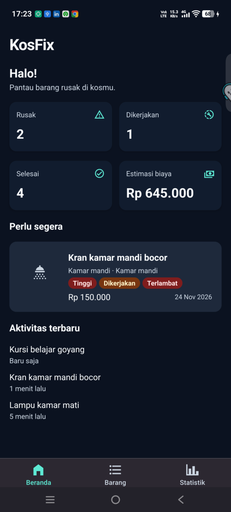
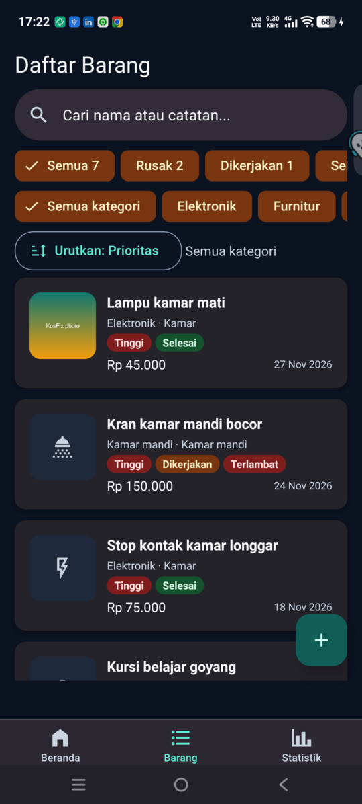
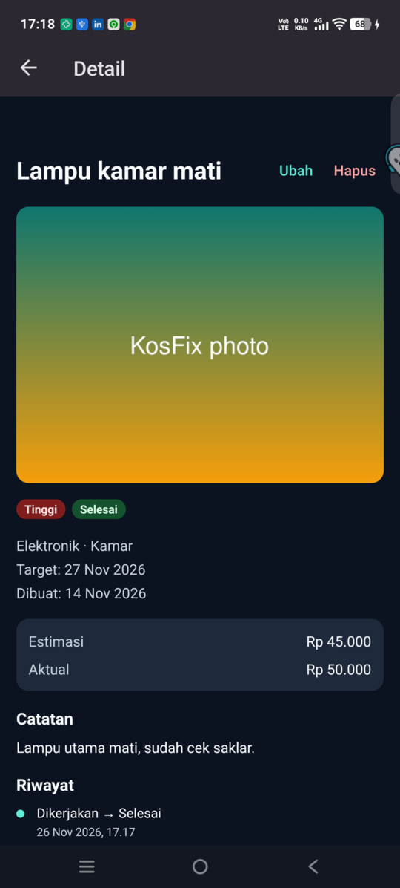
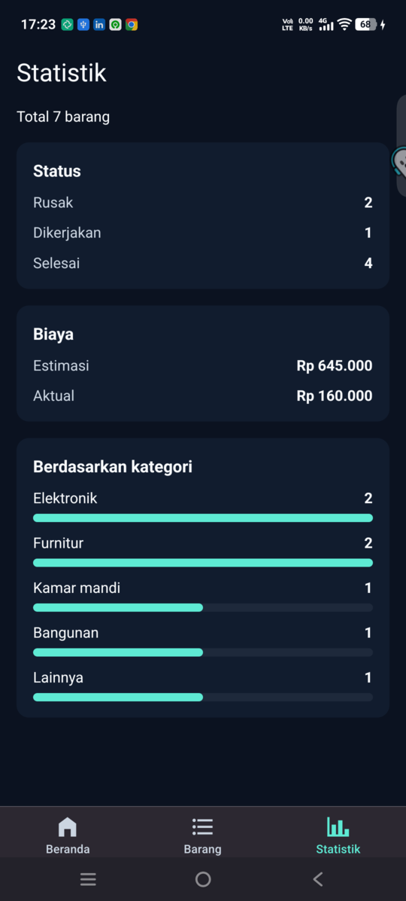

# KosFix

**Catat, perbaiki, beres.**

KosFix is a local-first Android app for recording broken items in a rented room
or kos. It keeps a photo, repair status, timeline, costs, and a reminder for
every item, and shows what still needs attention.

## Screens

| Screen                   | What it does                                                                                                              |
| ------------------------ | ------------------------------------------------------------------------------------------------------------------------- |
| **Beranda**              | Summary of broken, in-progress, and completed items, estimated cost, items that need attention, and recent activity.      |
| **Barang**               | Searchable list with status and category filters, sort options, and a FAB to add an item.                                 |
| **Detail**               | Photo, priority/status, target date, estimated and actual cost, notes, repair timeline, status actions, edit, and delete. |
| **Tambah / Ubah Barang** | Photo from camera or gallery, name, category, location, priority, costs, target date, notes, and an optional reminder.    |
| **Statistik**            | Counts by status, estimated and actual totals, and a breakdown by category.                                               |

| Beranda                          | Barang                           | Detail                            | Statistik                           |
| -------------------------------- | -------------------------------- | --------------------------------- | ----------------------------------- |
|  |  |  |  |

## Stack

| Layer      | Choice                                                        |
| ---------- | ------------------------------------------------------------- |
| Runtime    | Expo SDK `~58.0.26`, React Native `0.88.1`, React `19.3.0`    |
| Language   | TypeScript `~6.0.3`, strict mode                              |
| Navigation | React Navigation 7 (`native-stack` + `bottom-tabs`)           |
| UI         | React Native Paper `5.15.5`, Material 3, light/dark themes    |
| Storage    | `expo-sqlite` `~58.0.18`                                      |
| Media      | `expo-image-picker` `~58.0.10`, `expo-file-system` `~58.0.14` |
| Reminders  | `expo-notifications` `~58.1.9`                                |
| Dates      | `@react-native-community/datetimepicker` `9.2.1`              |
| Tests      | Jest `30.5.2`, React Native Testing Library `14.1.0`          |

## Requirements

- Node.js `26.13.1`
- pnpm `12.23.0`
- JDK 17 (Temurin); JDK 21+ is not the tested Gradle baseline
- Android SDK Platform `37` and Build Tools `37.0.0`
- `adb` and an Android device with USB debugging enabled

The repository pins Node, pnpm, and Java with [Proto](https://moonrepo.dev/proto)
(`.prototools`). Run `proto install` once, or install the same versions through
your package manager. The Android scripts automatically use the pinned tools
when Proto is available.

## Development

```bash
pnpm install
pnpm android:device   # build and install the development client
pnpm start            # Metro for the development build
```

`pnpm android:device` uses Expo's device picker when more than one device is
connected. The development build is only needed while working on the app; the
release APK runs on its own.

## Scripts

| Command               | Purpose                                                |
| --------------------- | ------------------------------------------------------ |
| `pnpm start`          | Start Metro.                                           |
| `pnpm android`        | Build and install the development build.               |
| `pnpm android:device` | Same as above, selecting a device.                     |
| `pnpm test`           | Run Jest.                                              |
| `pnpm test:watch`     | Run Jest in watch mode.                                |
| `pnpm typecheck`      | Run `tsc --noEmit`.                                    |
| `pnpm lint`           | Run ESLint.                                            |
| `pnpm format`         | Format the repository with Prettier.                   |
| `pnpm format:check`   | Verify formatting without writing.                     |
| `pnpm build:apk`      | Build the standalone release APK at `dist/kosfix.apk`. |

## Release APK

```bash
pnpm build:apk
adb install -r dist/kosfix.apk
```

The release APK is a standalone Android build:

- release variant, debug-signed for sideloading;
- runs without Metro;
- built for `arm64-v8a` and `armeabi-v7a`;
- Android only.

The debug keystore is intentional for local distribution and the exam build. Do
not use this APK for a store release; a store build needs a private signing key.

## Continuous integration

`.github/workflows/ci.yml` runs on pushes to `main` and on pull requests:

1. **checks** — `pnpm install --frozen-lockfile`, `typecheck`, `lint`,
   `format:check`, and `test --ci`;
2. **apk** — the same install and gates on Ubuntu with Temurin 17, Android SDK
   37, Gradle caching, then `pnpm build:apk`.

The APK job uploads the `kosfix-apk` artifact with 30-day retention. Download
it from the workflow run, extract `kosfix.apk`, and install it with
`adb install kosfix.apk`.

## Data and privacy

Everything stays on the device: a local SQLite database and photo files in the
app's private storage. There is no account, backend, network sync, analytics, or
cloud call. Deleting an item removes its photo file and cancels its reminder.

## Known limitations

- **Reminder timing is approximate.** Reminders are scheduled for 09:00 on the
  selected date. Android treats these as inexact alarms, so delivery can be
  delayed. Some OEM battery managers also freeze background apps; the app works
  best when it is allowed to run in the background.
- **No exact alarms.** The app does not request the Android exact-alarm
  permission.
- **Android only.** There is no iOS build, simulator flow, EAS build, or Play
  Store release.
- **Sideload signing.** The release APK uses the debug keystore.
- **Local only.** No multi-device sync, sharing, or backup.

## Structure

```text
App.tsx                 bootstrap, providers, navigation, notification observer
src/shell/              service bootstrap, root navigator, services context
src/screens/            Home, Items, Detail, Form, Stats
src/components/         shared Material 3 components
src/domain/             types, validation, filters, sorting, stats, reminders
src/data/               SQLite schema, migrations, seed, repository, queries
src/services/           notifications and photo storage
src/theme/              Paper and React Navigation light/dark themes
src/test/               fakes, factories, render helpers
plugins/                Gradle build configuration for prebuild
scripts/                Android development and APK build helpers
.github/workflows/      checks and APK artifact workflow
```

## Verification

```bash
pnpm typecheck
pnpm lint
pnpm format:check
pnpm test --ci
```

The test suite covers the domain rules, the SQLite repository and seed logic,
the notification and photo services, and every screen. The Android native paths
are verified with the development build and the standalone APK on a physical
device.
